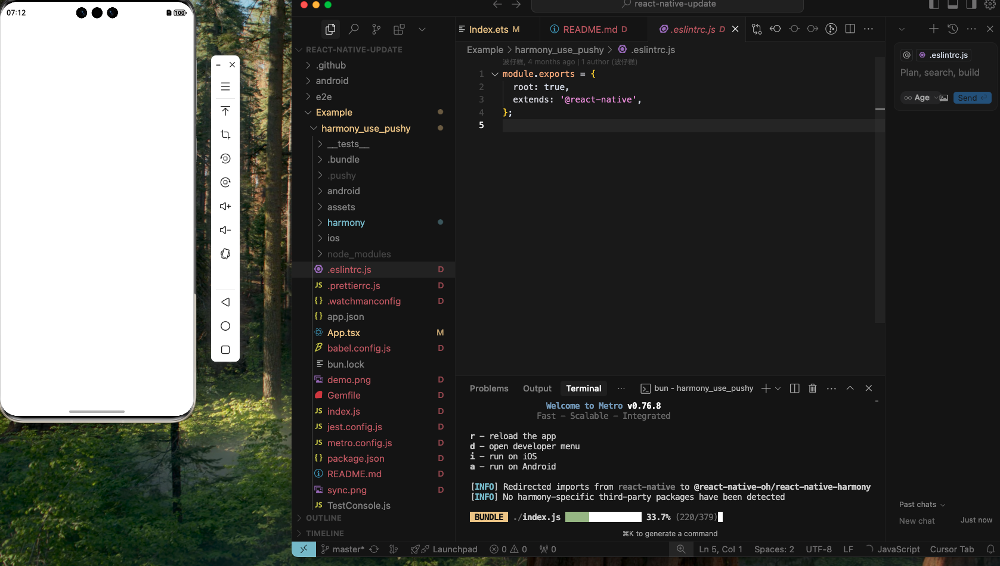
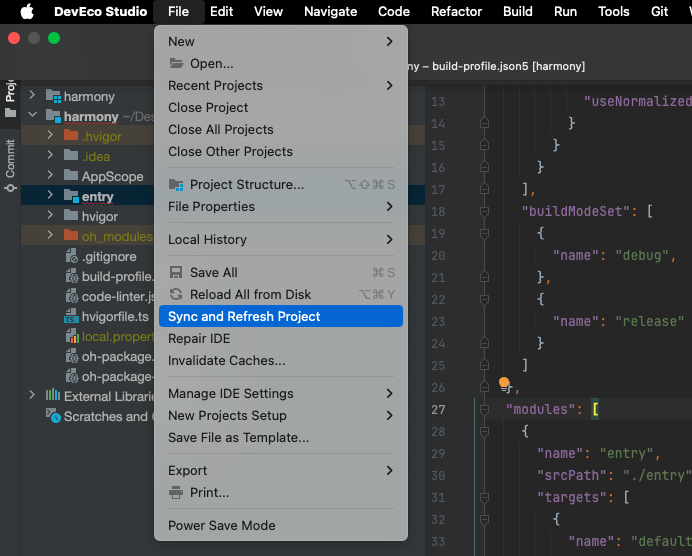
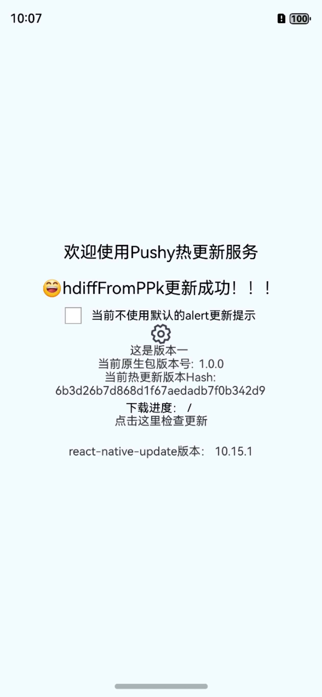

## 运行harmony_use_pakta项目步骤

### 1. 暂存当前 SDK 候选，再冻结安装依赖

样例消费本地 `.local-sdk/rn-update.tgz`，该目录不会提交。先提供本轮已验证候选的绝对路径和完整 SHA256，在相邻 `e2etest` 工程运行 stage；它只核对并复制候选，不安装依赖、不接触设备或签名。

```powershell
$env:RNU_HARMONY_SDK_TGZ = 'C:\artifacts\rn-update-candidate.tgz'
$env:RNU_HARMONY_SDK_SHA256 = '<完整 64 位 SHA256>'
node ../e2etest/scripts/run-harmony-e2e.js stage
bun install --frozen-lockfile --backend copyfile
node ../e2etest/scripts/run-harmony-e2e.js sync
```

`sync` 核对候选生产源码与本仓库一致，并确认 React/RN/RNOH 都解析到样例依赖树。不要把依赖改回 registry 旧版或 SDK 根 `file:../..`；后者会把根开发依赖带入宿主。更换候选时由维护者更新并审查 `bun.lock`，普通重跑保持冻结校验。完整跨平台构建与设备命令见 [Harmony E2E 地图](../e2etest/scripts/harmony-e2e-map.md)。

### 2. 本地debug 模式
```
bun run start
```


### 3. release 模式: 在项目根目录执行下面命令生成bundle包文件。
```
bun run build
```
说明：这个命令会在harmony/entry/src/main/resources/rawfile目录生成Hbundle.harmony.js和assets文件，同时会基于该内容在.pakta/output目录生成ppk包。

**注意⚠️**：在使用pakta bundle --platform harmony命令进行打包的默认bundle包名是Hbundle.harmony.js，不要随意修改包名，因为diff是匹配该包名进行生成的。

### 4. 使用DevEco Studio IDE打开harmony目录然后执行sync运行项目


### 5 运行效果图

