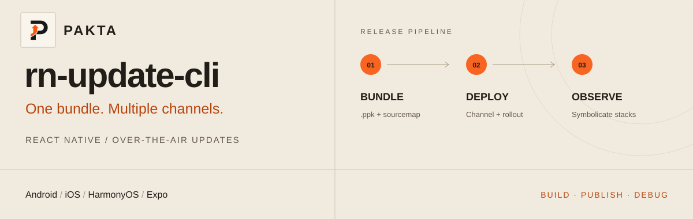

# rn-update-cli · React Native 热更新发布工具



[](https://www.npmjs.com/package/rn-update-cli)
[](./LICENSE)
[](#quick-start)

### 从一次打包，到多渠道发布。

为 **React Native、Expo、HarmonyOS** 构建并发布 **OTA 热更新**。原生包登记、灰度投放、CI/CD 与 sourcemap 归档，一套命令完成。

[English](./README.md) · [Pakta](https://pakta.site/zh-CN/) · [快速开始](#quick-start) · [命令行工具文档](https://pakta.site/zh-CN/docs/cli/) · [SDK](https://github.com/pakta-team/rn-update/tree/main/rn-update/README-CN.md) · [价格](https://pakta.site/zh-CN/pricing/)

---

## 从构建到发布，一条清晰的路径

| 能力 | 你可以做什么 |
| --- | --- |
| **跨平台打包** | 登记 APK / AAB / IPA / HarmonyOS APP，生成 `.ppk` 更新包 |
| **按渠道灰度** | 一份制品面向多个渠道和原生版本，分别设置投放比例 |
| **CI/CD 自动化** | 令牌认证、无交互发布、零写入预检与准确投放重试 |
| **Hermes 与诊断** | 复用并校验 Hermes 基线，归档 sourcemap、还原错误堆栈 |

<a id="quick-start"></a>

## 快速开始

需要 **Node.js ≥18.17**、目标平台构建工具链，以及已完成原生接入的 [rn-update SDK](https://github.com/pakta-team/rn-update/tree/main/rn-update/README-CN.md)。以下命令在 React Native 工程根目录执行。

### 1. 安装并选择应用

在 [Pakta 控制台](https://pakta.site) 注册并验证邮箱后：

```bash
npm install -g rn-update-cli
pakta login
pakta selectApp --platform android
```

还没有应用？先运行 `pakta createApp --platform android --name MyApp`。每个平台分别选择，配置保存在 `update.json`。

### 2. 登记已分发的原生包

```bash
pakta uploadApk ./app-release.apk
```

其他格式使用 `uploadAab`、`uploadIpa`、`uploadApp`。原生包是 OTA 的兼容基线。

### 3. 打包，以 10% 灰度发布

```bash
pakta bundle --platform android --output .pakta/output/android.ppk --no-interactive
pakta publish .pakta/output/android.ppk --platform android --name fix-001 --channel default --packageVersion 1.0.0 --rollout 10 --sourcemap .pakta/intermedia/android/index.bundlejs.map
```

将 `default` 和 `1.0.0` 替换为已登记的渠道、原生版本；Expo 打包添加 `--expo`。**省略 `--rollout` 默认全量投放。**

<details>
<summary><strong>发布行为与渠道规则</strong></summary>

固定 `--output` 避免猜测带时间戳的文件名。`bundle --name ...` 会触发发布；只打包时省略 `--name`。

交互发布未指定目标时，上传后询问是否绑定原生包；拒绝则仅保存制品。无交互发布须指定 `--targets`、`--packageId` 或 `--packageVersion`。

渠道来自原生包元数据，缺省 `default`；上传参数 `--channel` 只校验、不改写身份。独立服务上传/发布自动创建缺失渠道。同渠道、同原生版本不能登记不同 JS 指纹，`buildTime` 保持原始字符串。

</details>

## 多渠道与 CI/CD

创建 `targets.json`，每项是一条独立投放：

```json
[
  { "channel": "default", "packageVersion": "1.0.0", "rollout": 10 },
  { "channel": "huawei", "packageVersion": "1.0.0", "rollout": 30 }
]
```

CI 中设置 `RNU_SERVICE_URL`，通过密钥管理注入账号设置生成的个人令牌 `PAKTA_API_TOKEN`。对已生成的制品先预检，再发布：

```bash
pakta publish .pakta/output/android.ppk --platform android --targets targets.json --dryRun --no-interactive
pakta publish .pakta/output/android.ppk --platform android --targets targets.json --name fix-001 --sourcemap .pakta/intermedia/android/index.bundlejs.map --no-interactive
```

`--dryRun` 不上传、不创建渠道、不写更新包或投放。每项 `rollout` 优先于全局参数，两者均省略则为 100%。保存返回的 `packageId` 与 `deploymentIds`，失败后按准确投放 ID 重试：

```bash
pakta publish --deploymentIds DEPLOYMENT_ID_1,DEPLOYMENT_ID_2 --platform android --no-interactive
```

## 命令速查

| 用途 | 命令 |
| --- | --- |
| 账号 | `login`, `logout`, `me` |
| 应用 | `createApp`, `apps`, `selectApp`, `deleteApp` |
| 渠道 | `channels`, `createChannel`, `updateChannel`, `deleteChannel` |
| 原生包 | `uploadApk`, `uploadAab`, `uploadIpa`, `uploadApp`, `packages`, `deletePackage` |
| 解析 | `parseApk`, `parseAab`, `parseIpa`, `parseApp`, `extractApk` |
| OTA | `bundle`, `publish`, `versions`, `update`, `updateVersionInfo`, `deleteVersion` |
| 差分 | `hdiff`, `hdiffFromApk`, `hdiffFromIpa`, `hdiffFromApp`, `registerPdiff` |
| 诊断 | `symbolicate`, `cache`, `cache clean` |

本地 `hdiff*` 只生成补丁，精确原生构建补丁需另行通过 `registerPdiff` 登记。完整选项见 [cli.json](./cli.json).

## 进阶用法

<details>
<summary><strong>Hermes & sourcemaps</strong></summary>

`bundle` 默认生成 sourcemap，Hermes 工程会合成最终映射。用 `publish --sourcemap` 归档后还原错误堆栈：

```bash
pakta symbolicate stack.txt --platform android --hash UPDATE_HASH
```

hash 来自 SDK 的 `getUpdateMetadata().currentVersion`；也可使用 `--versionId`，`-` 表示从 stdin 读取堆栈。

Hermes 默认 `--hermesBase auto` 复用历史基线，`none` 关闭，也可传 `.hbc/.ppk/.apk/.ipa` 路径。`--verifyHermesBase` 会先比较易读反汇编，再用完整二进制字符串、常量、函数引用和控制流目标核对 raw HBC 操作数；未知或无法读取的布局直接 fail-closed 并回退普通编译。版本探测、完整校验、编译/源码映射子进程期限默认分别为 30/120/300 秒，可用 `PAKTA_HERMES_PROBE_TIMEOUT_MS`、`PAKTA_HERMES_VERIFY_TIMEOUT_MS`、`PAKTA_HERMES_COMPILE_TIMEOUT_MS`（毫秒）调整。补丁大小取决于实际构建。详见 [Hermes base verification](./docs/hermes-base-verification.md).

Sentry 需配置平台的 `sentry.properties`，通过 `@sentry/react-native/metro` 保持 bundle/map Debug ID 一致，并使用 `bundle` 发布流程自动上传。旧版 Sentry 可指定 `--sentry-release`、`--sentry-dist`，与运行时保持一致。

</details>

<details>
<summary><strong>Provider API</strong></summary>

仅构建脚本导入 API 时，安装项目开发依赖：

```bash
npm install --save-dev rn-update-cli
```

先配置服务和认证。下面代码放入 async 函数或支持顶层 await 的模块：

```typescript
import { CLIProviderImpl } from 'rn-update-cli';

const provider = new CLIProviderImpl();
const bundle = await provider.bundle({
  platform: 'android',
  output: '.pakta/output/android.ppk',
  sourcemap: true,
});
if (!bundle.success) throw new Error(bundle.error);

const release = await provider.publish({
  filePath: '.pakta/output/android.ppk',
  sourcemap: '.pakta/intermedia/android/index.bundlejs.map',
  platform: 'android',
  name: 'fix-001',
  targets: 'targets.json',
});
if (!release.success) throw new Error(release.error);
```

返回 `CommandResult`，消费 `data` 前检查 `success`。完整接口见 [src/types.ts](./src/types.ts).

</details>

<details>
<summary><strong>连接自己的服务</strong></summary>

默认后端为 `https://pakta.yoghourt.space`；CLI 自动补充 `/admin/api/v1`。切换部署时设置：

```bash
export RNU_SERVICE_URL=https://YOUR_HOST
```

PowerShell:

```powershell
$env:RNU_SERVICE_URL = 'https://YOUR_HOST'
```

登录凭据按服务地址隔离。

</details>

<details>
<summary><strong>环境变量与 CLI 自动更新</strong></summary>

| 变量 | 用途 |
| --- | --- |
| `RNU_SERVICE_URL` | 独立服务地址 |
| `PAKTA_API_TOKEN` | CI 个人访问令牌 |
| `NO_INTERACTIVE=true` | 关闭交互 |
| `RNU_LANG` | 可选语言覆盖：`zh`/`zh-CN` 使用中文，其他值使用英文。未设置时依次读取 `LC_ALL`、`LC_MESSAGES`、`LANG` 和系统 locale。 |
| `RNU_DEBUG=1` | 输出错误堆栈 |
| `HTTPS_PROXY` / `HTTP_PROXY` / `NO_PROXY` | 代理，支持小写形式 |
| `PAKTA_CACHE_DIR` | Hermes base 缓存目录 |
| `PAKTA_HERMES_PROBE_TIMEOUT_MS` / `PAKTA_HERMES_VERIFY_TIMEOUT_MS` / `PAKTA_HERMES_COMPILE_TIMEOUT_MS` | Hermes 探测、等价校验与编译/源码映射期限，单位毫秒 |
| `RNU_AUTO_UPDATE=0` | 关闭后台自动更新 |

全局 CLI 在成功执行后可通过原包管理器后台更新，沿用 registry、认证、代理和全局目录配置。CI、本地依赖和 npx 安装不会被修改。也可设置 `RNU_DISABLE_AUTO_UPDATE=1` 关闭，或用 `RNU_AUTO_UPDATE_PACKAGE_MANAGER` 指定 npm、pnpm、yarn、bun。

</details>

---

[MIT](./LICENSE) · Copyright (c) 2026 Yoghourt Technology(BeiJing) Company Limited.
